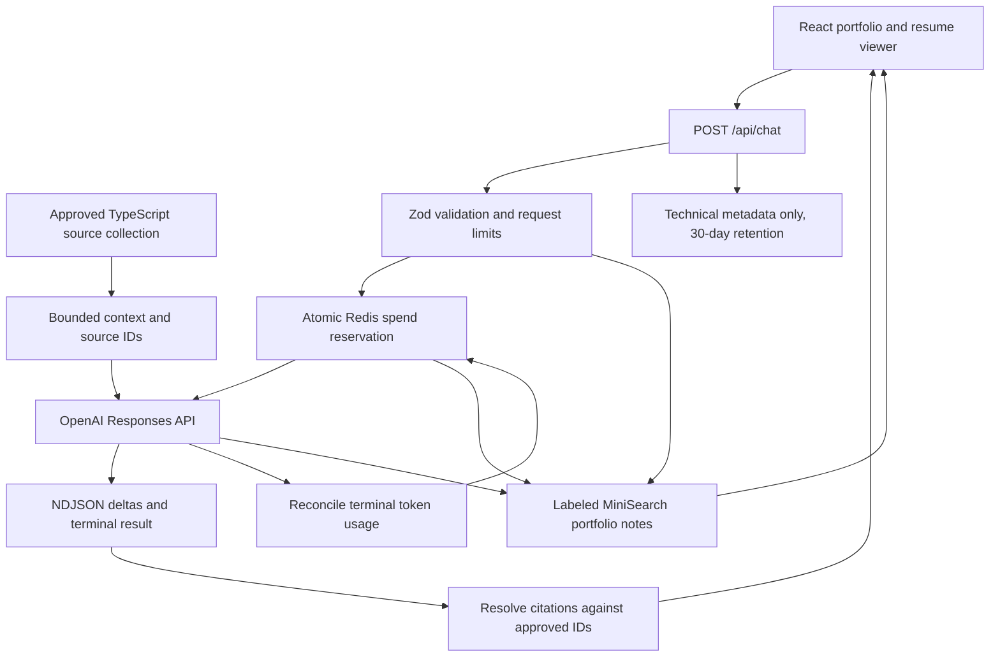

# Architecture

This is an applied LLM application: the engineering work is in grounded context, evaluation, interaction design, and operating a bounded public endpoint. There is no model-weight training or autonomous tool execution.

## Request path

`api/chat.ts` adapts the shared Node handler in `server/chat.ts` for Vercel. Vite mounts the same handler in development. The model receives the approved source collection, at most ten recent messages, the current question, and an optional validated resume excerpt. Excerpts and conversation messages are evidence to interpret, not instructions that can overwrite the biography.

OpenAI requests use the Responses API, reasoning disabled, the standard service tier, a 900-token output ceiling, `store: false`, and no SDK retries. The server's 25-second provider timeout fits within the Vercel function's 30-second duration. These are configured bounds, not an uptime or latency SLA.

## Grounding and retrieval

The public biography is structured TypeScript data. `portfolio-answer.ts` assembles a stable source collection with IDs, text, and approved destinations. The model emits source IDs; the application resolves links from that collection rather than trusting arbitrary model-authored URLs.

The live request includes the bounded collection in context. It does not perform embedding search, use a vector database, or train on visitor messages. MiniSearch serves a separate deterministic notes experience when inference is unavailable. This choice keeps a small personal knowledge base easy to inspect; context cost grows with the collection, so larger corpora would need a separately evaluated retrieval stage.

A valid citation ID is only a structural check. The referenced text can still fail to support a claim. The holdout evaluation scores those cases separately rather than treating citation existence as factual accuracy.

## Streaming and browser state

The server translates provider events into newline-delimited JSON: `start`, `delta`, `complete`, or `fallback`. Completion requires a valid terminal provider event. Interrupted or invalid responses become explicitly labeled notes; partial model output is not passed off as a finished answer.

Conversation turns, drafts, and resume quotes live in tab-scoped session storage. Starting or switching conversations cancels the active request while retaining its partial text. The resume viewer preserves the prior route, supports download/open separately, and sends only the selected text with an explicit question. It does not upload the PDF as a training file.

Projects, reports, experience, recognition, and the manual use ordinary routes independent of inference. The interactive companion and animated suggestions are local UI behavior, not model calls.

## Spend and failure handling

Per-process guards cap concurrency and request frequency. On Vercel, paid calls also require Redis availability. A Lua script atomically checks minute/day/month counters and creates a short-lived reservation receipt before the provider is called.

The reservation assumes conservative input bytes, overhead, and the full output ceiling. On terminal responses, validated usage reconciles it, pricing cache reads/writes conservatively. The receipt is consumed atomically: duplicates cannot refund twice, rate counters are never refunded, and settlement stays with the reservation's original UTC month. Missing usage or settlement failure retains the reservation.

The implementation preserves the existing `portfolio:ai` production namespace so rollout does not reset current spend. Preview and development receive separate namespaces and lower limits. Local development without Redis still has per-process guards, but no shared app-level monthly cap; the provider development-project cap remains essential. See [API setup](api-setup.md) for the recovery history and the $8/$2 budget split.

Missing/invalid credentials, exhausted quota, unavailable storage, incomplete output, timeout, and cancellation all avoid an automatic paid-provider failover. The user can still browse or receive notes. A malicious visitor can consume the shared public allowance; quotas are not a complete abuse defense.

## Observability and secrets

Server-only environment variables hold API credentials. Production uses a dedicated service-account key; local evaluations and Preview use a different development-project key. Both are scoped to response generation. Git ignores local secret files and Vercel configuration.

Operational activity records contain timestamps, model/provider, outcome, response identifier when available, latency, and validated token counts. They do not contain prompts, responses, IPs, or visitor IDs. This is not a unique-visitor analytics system. The local dashboard binds to loopback and rejects cross-origin access; it is not deployed as a public admin route. See [usage monitoring](usage-monitoring.md).

`health:agent` distinguishes configured from live. The default GET is inexpensive but cannot detect a revoked credential. Explicit `--live` submits a brief paid question and requires model mode plus nonempty output. HTTP 200 fallback notes are considered unhealthy for this check. No recurring paid monitor is enabled automatically.

## Verification

| Layer | Evidence |
| --- | --- |
| Input, citation and fallback behavior | `tests/portfolio-agent.test.mjs` |
| Streaming/provider handling | `tests/model-comparison.test.mjs`, `tests/usage.test.mjs` |
| Reservation, settlement and environment boundaries | `tests/request-budget.test.mjs` |
| Chat state, resume and navigation | `tests/conversation-store.test.mjs`, `tests/workspace-ux.test.mjs` |
| Loopback dashboard and metadata boundaries | `tests/local-usage.test.mjs` |
| Health checks | `tests/agent-health.test.mjs` |
| Evaluation integrity and strict grading | `tests/evaluation.test.mjs`, `evals/results` |

The [evaluation report](evaluation.md) separates offline correctness, paid request completion, source-ID validity, and reviewed answer quality. Those measurements are not interchangeable.
